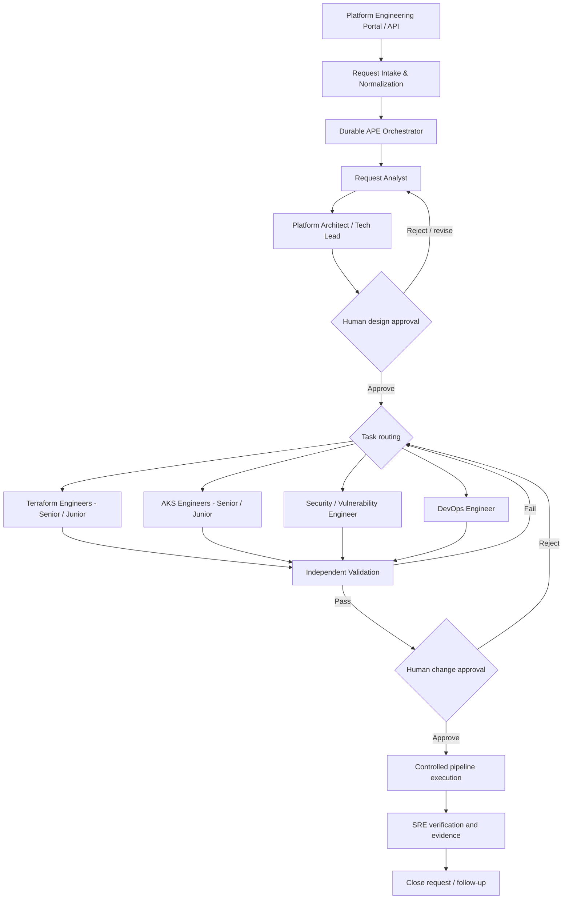
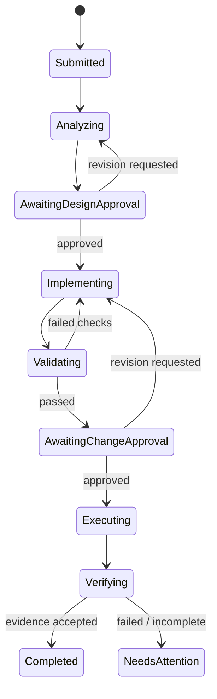

# Agentic Platform Engineering — Implementation Blueprint

## Objective
A user submits a platform engineering request (for example, provision an AKS cluster or remediate a batch of security findings). Specialized AI agents analyze, design, implement, test, propose and verify changes, subject to human approvals. Start with request-driven workflows; proactive monitoring is deferred.

## End-to-end architecture

## Agent roster

| Agent | Responsibilities | Deliverables |
|---|---|---|
| Request Analyst | Classify requests; clarify requirements; validate inputs | Structured engineering request |
| Platform Architect | Design, dependencies, impact, risk and ADRs | Design and execution plan |
| Engineering Tech Lead | Break down tasks; route by complexity and expertise | Work items and review assignments |
| Senior Terraform | State-sensitive modules, complex networking, migrations | Terraform changes and plan evidence |
| Junior Terraform | Variables, routine resources, approved module consumers | Terraform changes and tests |
| Senior AKS | Cluster topology, network, upgrades, identity, ingress | AKS/Helm design and PR |
| Junior AKS | Deployments, ConfigMaps, HPA, routine chart changes | Kubernetes manifests and PR |
| Security | CVEs, misconfigurations, exposure, RBAC, security review | Triage and remediation evidence |
| DevOps | Azure DevOps repos/pipelines, GitOps and release automation | PR and pipeline evidence |
| Validation | Independent Terraform/Kubernetes/security checks | Executed checks and results |
| SRE | Post-change telemetry, health and reliability verification | Operational evidence |

## Request workflows

### A. Infrastructure provisioning or modification
1. Submit target environment, subscription, repository, resource requirements and constraints.
2. Request Analyst checks completeness and clarifies unknowns.
3. Architect produces design, risk and implementation plan; human approves.
4. Tech Lead routes to Terraform/AKS/Security/DevOps as needed.
5. Agents generate code in isolated branches; no direct infrastructure mutations.
6. Validation runs `terraform fmt`, `terraform validate`, policy scans, and authorized `terraform plan` where credentials are available.
7. Human reviews PR, plan and security findings.
8. Authorized pipeline executes; SRE verifies; attach evidence and close.

### B. Bulk vulnerability remediation
1. Upload multiple CSV, XLSX, Markdown, JSON or SARIF reports and identify relevant repository/project/environment.
2. Deterministically parse and normalize findings; preserve original file, row, scanner ID and source evidence.
3. Map asset/resource, severity, CVE/CVSS, environment, subscription, ownership and remediation metadata; flag uncertainty for review.
4. Deduplicate carefully, group by demonstrable root cause while retaining per-finding traceability.
5. Security Agent triages severity/exposure/exploitability and proposes priorities.
6. Tech Lead assigns Terraform, AKS, Security or DevOps specialists; human approves scope.
7. Agents prepare PRs, tests and security checks; independent validation and human approval precede execution.
8. Rescan or other authoritative evidence verifies closure; absence from a later report alone is not definitive proof.

## Workflow state machine

## Core contracts

| Object | Fields / invariants |
|---|---|
| EngineeringRequest | id, type, identity-bound project, environment, repo, requirements, source references |
| WorkflowRun | id, request id, stage, status, transition history, retry policy |
| AgentTask | role, input artifact refs, dependencies, authorized tools, result status |
| Artifact | id, type, version, provenance, checksum, immutable content reference |
| Approval | gate, approver identity, artifact version, decision, timestamp, reason |
| VulnerabilityFinding | source file/row/scanner id, asset, severity, CVE, evidence, classification |
| RemediationGroup | root cause, linked finding IDs, proposed changes, owner |
| ChangeProposal | repo/branch/PR, plan, test evidence, risk and required approvals |
| ExecutionEvidence | pipeline run, result, verification and closure evidence |

## Technology choices

| Layer | Local MVP | Enterprise direction |
|---|---|---|
| Agent runtime | Python 3.12+, Microsoft Agent Framework (verify SDK APIs) | Foundry/OpenAI model deployments |
| API | FastAPI, Pydantic | AKS-hosted API |
| State | SQLite with migrations | Azure SQL |
| Artifacts | Local immutable artifact directory | Azure Blob Storage |
| Queue | Durable local dispatcher | Azure Service Bus |
| SCM | Git local worktrees | Azure DevOps Repos |
| Infrastructure | Terraform CLI, dry-run validation | Isolated execution jobs |
| Kubernetes | Offline schema/Helm validation | AKS read-only then approved actions |
| Security | Checkov/Trivy as available | Enterprise scanner connectors |
| Identity | Local developer identity | Entra ID / workload identity |
| Telemetry | Structured logging and OpenTelemetry | Splunk Cloud |

## Safety and isolation
Project and tenant identity must derive from authenticated context, not LLM output. Model calls cannot grant permissions. Treat reports, repos and tool output as untrusted input. Enforce per-tool allowlists and scoped credentials. Human gates are durable and artifact-version-bound. Production deployment and security exceptions require explicit authorization. Avoid running untrusted generated code with broad cloud credentials.

## Phase exit criteria

| Phase | Scope | Exit criterion |
|---|---|---|
| 0 | Durable workflow engine, registry, tool policy, audit, approvals, minimal API | Request persists; approved/rejected transitions, restart/recovery, and tests work |
| 1 | Request Analyst + Architect | Real model-backed structured design; approval gate; provenance |
| 2 | Senior/Junior Terraform | Real isolated branch and Terraform PR; actual fmt/validate/scan evidence |
| 3 | Senior/Junior AKS | Validated manifests/Helm changes and reviewable PR |
| 4 | Bulk vulnerability ingestion, triage, remediation | Mixed-format import, evidence preservation, traceability and remediation PR |
| 5 | DevOps, independent validation, SRE | Controlled CI/CD and post-change verification |
| 6 | Enterprise multi-tenancy and integrations | Identity isolation, audit, queueing, scanner connectors and operational hardening |

## First demo
Submit: "Provision an Azure Storage Account using an approved Terraform module with private endpoint and DNS." Produce a structured request, architecture artifact, durable approval and task plan. Phase 0 stops before real Terraform generation.
